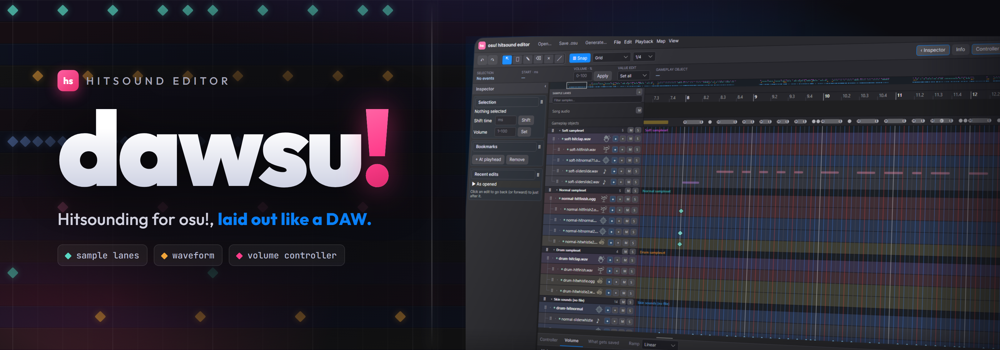
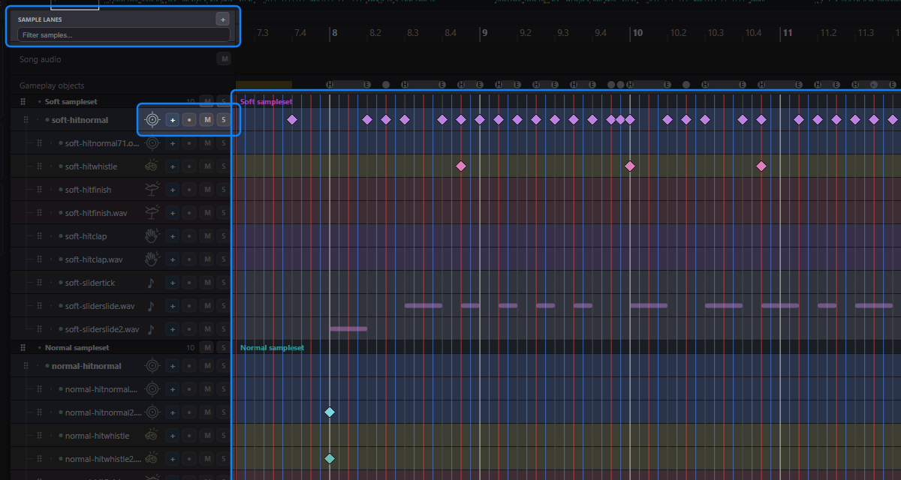

# dawsu! hitsounding editor

A Windows editor for osu! hitsounds. Each sample in a mapset becomes a lane you draw hits on, over the song's waveform, and the editor writes them back into the map.



## What it does

**Hitsound mode**
- Open a `.osu` or `.osz` (or drop one on the window) and draw, move and erase hits on sample lanes, snapped to the beat grid.
- Set volumes per object in the controller, with ramps.
- **Save .osu** writes the hitsounds into the difficulty (a backup is kept outside the mapset). It uses osu!'s native sound combinations where it can and mixes samples only where it must.
- **Generate…** makes a separate hitsound difficulty, and **Map → Copy hitsounds…** copies it into the other difficulties, like Mapping Tools' Hitsound Copier.
- Drum maps, reusable sound sets, and a drum VST for playback and WAV export.

**Keysound mode** (start screen → Keysounding)
- A project made from a reference beatmap, with instrument tracks in a piano roll (Cubase-style editing).
- Draw notes, import MIDI, or play and record from a MIDI keyboard.
- Each track plays the bundled piano or a VST3 instrument. Every plug-in runs in its own process, so a crash only silences its track.
- **Sync…** moves notes onto the map's circles, slider ends and spinner ends.
- **Generate…** renders every synced note to its own WAV and writes a playable `[Keysounds]` copy of the map. You can then export it as a `.osz`.

## Getting started

1. Download the latest release from [Releases](https://github.com/YogeGod/dawsu-hitsounding-editor/releases), extract the whole ZIP, and run `OsuHitsoundEditor.exe`.
2. Set your osu! Songs folder in **Preferences**.
3. Open a map. The first launch offers a short **Quick start** (it's also under **File → Quick start**).
4. Press **F1** for every shortcut and mouse action.

| Key | Action |
|---|---|
| 1–6 | Select, Grab, Draw, Erase, Mute and Ramp tools |
| Space | Play / stop |
| J | Snap on / off |
| Ctrl+S | Save |
| Ctrl+Z / Ctrl+Y | Undo / redo |
| Ctrl+wheel | Zoom in time |

## Building from source

With Windows and the .NET 10 SDK:

```powershell
dotnet run --project src/OsuHitsound.App
dotnet test OsuHitsoundEditor.slnx
```

VST3 instruments in Keysound mode need `dawsu_vst3_host.exe` next to the app. Build it with the steps in [native/Vst3IsolatedHost/README.md](native/Vst3IsolatedHost/README.md).

| Folder | Purpose |
| --- | --- |
| `src/OsuHitsound.App` | The editor window (Hitsound and Keysound modes) |
| `src/OsuHitsound.Audio` | Playback, the bundled piano and the VST3 client |
| `src/OsuHitsound.Format` | Reading and writing `.osu` files |
| `src/OsuHitsound.Lanes` | Lanes, hitsound compiling, and the Keysound model |
| `native/` | The VST hosts (C++) |
| `tests/`, `tools/` | Automated tests and test helpers |
| `docs/` | Design notes and screenshots |

## Credits

- Default hitsounds from [osu!](https://github.com/ppy/osu-resources) by ppy and contributors ([CC BY-NC 4.0](https://creativecommons.org/licenses/by-nc/4.0/)).
- Copy hitsounds follows [Mapping Tools](https://github.com/OliBomby/Mapping_Tools)' Hitsound Copier by OliBomby (MIT).
- Audio decoding by [BASS](https://www.un4seen.com) (free for non-commercial use); output through [NAudio](https://github.com/naudio/NAudio) (MIT).
- Waveform colours follow [osu-framework](https://github.com/ppy/osu-framework)'s Waveform (MIT).
- The bundled piano is the FreePats Upright Piano KW (CC0). VST3 hosting uses the Steinberg VST 3 SDK (MIT).

Full licence texts are in [THIRD-PARTY-NOTICES.txt](src/OsuHitsound.App/THIRD-PARTY-NOTICES.txt).
