# dawsu! hitsounding editor

A Windows editor for dawsu! hitsounds, with sample lanes, a song waveform and a volume controller.

## Tutorial

The editor also has a built-in tour: **File → Tutorial**.

### Open, save and generate

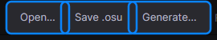

- **Open…** (Ctrl+O): open a `.osu` from your Songs folder, or drag a `.osu` or `.osz` onto the window. Each sample file in the mapset becomes a lane you can draw in.
- **Save .osu** (Ctrl+S): write your hitsounds back into the map. A backup of the old file is kept outside the mapset.
- **File → Revert to last saved…**: reload the saved `.osu` after confirmation, discarding unsaved hits and bookmarks and clearing undo history. Lane layout, playback settings, playhead and timeline view are kept. You can assign a shortcut in Preferences → Keys.
- **Generate…**: make a separate hitsound difficulty from your hits, ready to copy into the other difficulties with **Map → Copy hitsounds…** (see [Copy hitsounds](#copy-hitsounds)).

Opening a difficulty automatically creates a separate working mapset in the **osu! Songs folder configured in Preferences**, then edits that copy. Later opens reuse it without overwriting your work. Copied beatmap IDs are cleared; the source mapset is kept intact. The map title's tooltip shows the opened path.

The **Audition** toggle beside the snap controls switches sample playback on/off when drawing or painting new notes. Its state is saved globally. Lane preview buttons and normal playback remain available.

In the inspector, **Channel** follows the active lane. Choose an existing sample or **Browse sample…** to replace that lane's sample; its notes move to the replacement and can be undone. Imported audio gets a fresh sample index, keeping existing shared files intact. **File browser** switches between sample browsing/auditioning and map/difficulty browsing. Select a lane before using a sample. Its folder controls let you browse external sample libraries too.

Click a base sound's disclosure arrow to fold or unfold its numbered sample lanes above index 1. Folded notes still play and export normally; the folded state is saved with the project. Searching the lane list reveals matching numbered lanes even while the family is folded.

Generate reuses unchanged mixed samples and continues new filenames after its last generated index. It skips occupied numbers without jumping past unrelated high indexes. Existing sample files keep their names.

When layers overlap, Generate offers a separate **export priority** list. The highest-priority participating addition automatically chooses the output slot, including combinations of different additions; loaded combination rules override that choice. All input sounds and their relative volumes are retained. Slider ticks and slide/whistle loops remain as separate timed hits in the generated difficulty and never enter the regular merge combinations. **Save merge preset…** and **Load preset…** explicitly reuse priorities and overrides; presets are not loaded automatically. New or changed combinations follow the priority order. Cancelling before Generate writes nothing to the mapset. This workflow applies to Generate, not Copy hitsounds.

Slider ticks and slide or whistle segments are rendered into timed samples in the generated difficulty. Generate stops and names the sample if a required sound cannot be read or decoded.

You can also import an `.osz`, reopen a recent map, or open the map's folder (**File → Open map folder**, Ctrl+Shift+O) from the **File** menu. Sample files you put in that folder show up as lanes as soon as you switch back to the editor.

### Menus and settings

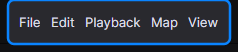

Every command is also in the menus: File, Edit, Playback, Map and View.

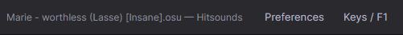

- **Preferences**: your Songs folder, the audio output (WASAPI shared or exclusive, ASIO, DirectSound or MME) and its device, and key commands. Hitsounds are mixed with the song sample-accurately, so they stay in time on every output; if an output can't start (an ASIO device that isn't connected, say), the editor uses WASAPI shared and tells you why.
- **Keys / F1**: a searchable list of every shortcut and mouse action.

### Tools

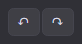 

Undo and redo with Ctrl+Z and Ctrl+Y. Pick a tool with its button or number key:

| Tool | Key | What it does |
|---|---|---|
| Select | 1 | Click a hit to select it, Ctrl/Shift+click to add more, drag a box around several, drag to move them. |
| Range | 2 | Drag a time range across lanes, then **Edit → Edit range…** to copy, move or delete it. |
| Draw | 3 | Click or drag along a lane to place hits. Hold Alt to draw with any tool. |
| Erase | 4 | Drag across hits to remove them. Right-click deletes a hit with any tool. |
| Mute | 5 | Silence a hit while you listen. Mutes are never saved into the map. |
| Ramp | 6 | Drag in the volume controller to draw a smooth volume ramp. |

### Snap, view and zoom


- **Snap** (J): when on, hits land on the beat grid.
- **Grid / Grid relative**: put moved hits on grid lines, or move them by whole steps and keep their offset.
- **1/4, 1/8…**: how fine the grid is (Shift+1–9).
- **Triplets**: filters Alt+wheel to 1/1, 1/3, 1/6 and 1/12. With it off, Alt+wheel cycles 1/1, 1/2, 1/4, 1/8 and 1/16. The drop-down and Shift+number shortcuts still offer all divisions.

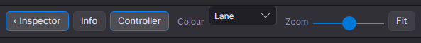

- **Inspector, Info, Controller**: show or hide those panels.
- **Colour**: colour hits by lane, or by volume (quiet hits dark, loud hits bright).
- **Zoom** in time (also Ctrl+wheel), Ctrl+Shift+wheel to make the rows taller or shorter, and **Fit** to see the whole map.

### Selection and song

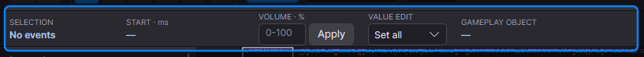

Shows what's selected. Type a volume and press **Apply**: *Relative* adds it to each hit, *Set all* gives them all that value.

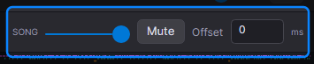

The song's volume, mute and offset (in ms). These are for listening only and aren't saved into the map.

The Offset box is remembered for each map. **Preferences → Song offset for all maps (ms)** adds a global adjustment (default −17 ms). Both adjustments apply to song playback and its waveform.

### Inspector

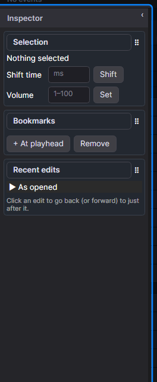

Shift or set the volume of the selection, add bookmarks, and click any entry under **Recent edits** to go back to it. Click a card's title to fold it; drag ⠿ to reorder cards.

### Lanes and the grid

Drag a dotted lane grip to reorder that lane inside its folder. Drag a folder grip to move it with all its lanes. Layouts are remembered per map; Ctrl+Z and Ctrl+Y undo and redo layout moves alongside note edits.


- **Sample lanes**: grouped by sampleset. Each group starts with osu!'s default sounds (hitnormal, whistle, finish, clap), with the map's own sample files under the sound they replace. The default sounds are built in, so they play even without osu! installed. Use the filter to find a lane. Above the list, **+** adds a lane for a sample file already in the mapset, **−** deletes the highlighted lane (the one you touched last, marked with a blue bar), and **‹** hides or shows the lane names.
- **Lane buttons**: **+** picks an audio file and copies it into the mapset as a new sample for that sound (e.g. `drum-hitclap5.wav`, using a number no difficulty uses yet), **●** plays the sample, **M** mutes the lane and **S** solos it. The **Song audio** row has **M** and **S** too: solo the song to hear it without hitsounds.
- **Song audio**: the song's waveform, coloured by frequency: blue for lows (kicks, bass), purple for mids (snares, vocals) and yellow for highs (hi-hats, cymbals), so you can see where each drum hits. The colours can be changed in the UI inspector (Ctrl+Shift+I).
- **The grid**: your hitsounds in time, left to right. Red-striped columns can't be saved as drawn yet.

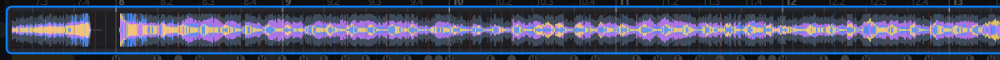

### Volume

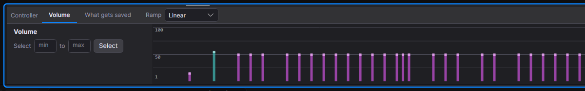

One bar per circle or slider end. Drag a bar to change its volume, Alt-drag to paint, Shift-drag for a ramp. osu! has one volume per object, so all lanes on that object share it.

### Playback

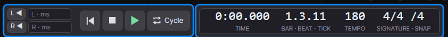

**L ◀** and **R ◀** jump to the L and R markers; type a time in ms in their boxes to move them. Then go to start, stop, play (Space) and **Cycle** between the L and R markers (L). Ctrl+click the ruler to set L, Alt+click to set R. Next to it: the time, bar.beat.tick, tempo and time signature.

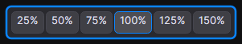

**Speed** plays slower or faster without changing the pitch, from 25 % to 150 %.

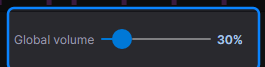

**Global volume** turns the song, hitsounds and previews up or down together.

### Copy hitsounds

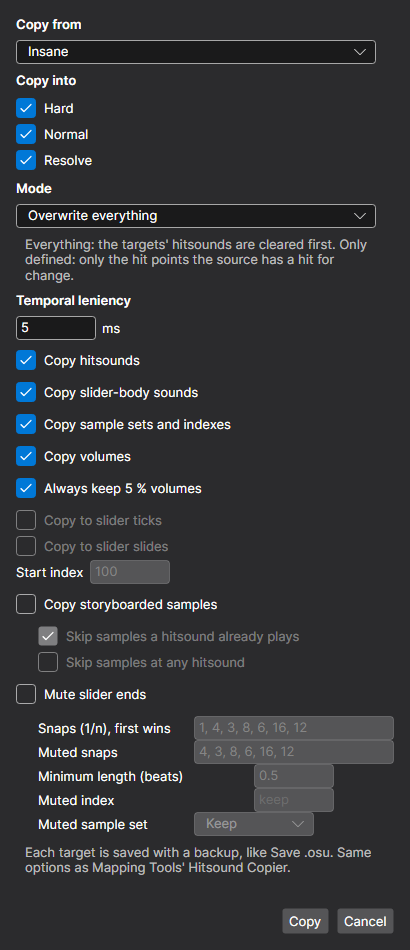

**Map → Copy hitsounds…** copies hitsounds from one difficulty of the mapset (usually your hitsound diff) into the others, the way [Mapping Tools](https://github.com/OliBomby/Mapping_Tools)' Hitsound Copier does, with the same options:

- **Overwrite everything** clears the targets' hitsounds first; **Overwrite only defined** changes only the hit points the source has a hit for.
- **Temporal leniency**: how far apart (ms) a source and a target hit may be to match.
- Copy hitsounds, slider-body sounds, sample sets and indexes, and volumes; always keep 5 % volumes.
- **Copy to slider ticks / slides** (Overwrite only defined): a source hit with no target hit goes onto a slider tick or slide as a new mixed sample, from the start index up.
- **Copy storyboarded samples**, skipping ones a hitsound already plays, or any at a hitsound.
- **Mute slider ends**: slider ends the source has nothing for play a hitnormal at 5 %, filtered by snap (first matching divisor wins) and minimum length.

Each target is saved with a backup, like **Save .osu**, and only the lines that change are rewritten. A slider body's index and volume follow the target's own green lines.

When several source hits at exactly the same time land on one target hit, their sounds are combined into a new sample. This also preserves the separate slider sounds from Generate. Keep **Copy sample sets and indexes** enabled for these combinations. If a required sample cannot be rendered, that target is left unchanged and the editor reports the problem.

The editor previews slider-slide and whistle loops, including sample and volume changes inside a slider. Tick copies keep the slider's sample bank, and **Copy volumes** and **Always keep 5 % volumes** also apply to generated samples. Copying to ticks or slides requires **Copy sample sets and indexes**, since each generated sample needs a new index.

## Download

Download the newest **C# editor preview** from [Releases](https://github.com/YogeGod/dawsu-hitsounding-editor/releases), extract the whole ZIP, and run `OsuHitsoundEditor.exe`. Keep the extracted files together.

## Building from source

With Windows and the .NET 10 SDK:

```powershell
dotnet run --project src/OsuHitsound.App
dotnet test OsuHitsoundEditor.slnx
```

## Project layout

| Folder | Purpose |
| --- | --- |
| `src/OsuHitsound.App` | The editor window, tools and inspector |
| `src/OsuHitsound.Audio` | Playback of the song and samples |
| `src/OsuHitsound.Format` | Reading and writing `.osu` files |
| `src/OsuHitsound.Lanes` | Turning a map's hitsounds into lanes and back |
| `tests/` | Automated tests |
| `tools/` | Screenshot and round-trip tools |
| `docs/` | Design notes and the tutorial's screenshots |

## Credits

The built-in default hitsounds are from [osu!](https://github.com/ppy/osu-resources) by ppy and contributors, used under [CC BY-NC 4.0](https://creativecommons.org/licenses/by-nc/4.0/). Copy hitsounds follows [Mapping Tools](https://github.com/OliBomby/Mapping_Tools)' Hitsound Copier by OliBomby (MIT). Songs and samples are decoded with [BASS](https://www.un4seen.com) (free for non-commercial use), and the sound goes out through [NAudio](https://github.com/naudio/NAudio) (MIT). The waveform's frequency colours follow [osu-framework](https://github.com/ppy/osu-framework)'s Waveform (MIT).
