# dawsu! hitsounding editor

A Windows editor for dawsu! hitsounds, with sample lanes, MIDI import/export, a song waveform and a volume controller. Its interface and workflow are heavily inspired by Cubase’s MIDI Drum Editor.

## Download

Download the Windows application from [Releases](https://github.com/YogeGod/dawsu-hitsounding-editor/releases), extract the complete ZIP, and run the editor executable. Keep the extracted files together.

## Source code

This repository contains the complete application source. You can clone it or use **Code → Download ZIP**.

With Windows, Node.js 24 or newer, and npm:

```powershell
npm install
npm install --no-save electron@44.5.0 @electron/asar@3.4.1
npx electron .
```

See [SOURCE-README.md](SOURCE-README.md) for tests, native-audio compilation and portable Windows packaging instructions.

## Features

- Import MIDI, `.osu`, `.osz` and saved `.hseproj` projects.
- Normal, Soft and Drum sampleset folders with expandable numbered layers, sample icons and fixed export mappings.
- Select, Draw, Erase, snapping, copy/paste, undo/redo and volume ramps.
- Separate hitsound volume and MIDI velocity controls.
- Detailed song waveform, gameplay-object timeline, zoom sliders and cycle playback.
- Timing points, time signatures, playback speed, song offset and global volume.
- Collapsible, movable inspector panels and a compact, collapsible selection-info bar.
- Named bookmarks and a searchable shortcut overview through **Keys / F1**.
- Normal beatmap export or a separate HS diff rhythm guide generated from hitsound-event times.
- Browser audio and native Windows output options, including WASAPI and ASIO.

## Project layout

| Folder / file | Purpose |
| --- | --- |
| `main.cjs`, `preload.cjs` | Electron application and desktop bridge |
| `index.html`, `src/` | Editor interface, audio, MIDI and dawsu! logic |
| `samples/` | Bundled samples and their attribution/licence files |
| `native-audio/` | C# audio helper, dependencies and build instructions |
| `test/` | Automated checks |
| `scripts/` | Windows packaging and icon tools |
| `examples/` | Example editor projects |

The dependency cache and packaged application archives are excluded from the repository. Bundled third-party components and samples retain their included licence notices.

## Tutorial

The editor also has a built-in tour: **File → Tutorial**.

### Open, save and generate

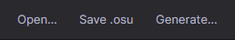

- **Open…** (Ctrl+O): open a `.osu` from your Songs folder. Each sample file in the mapset becomes a lane you can draw in.
- **Save .osu** (Ctrl+S): write your hitsounds back into the map. A backup of the old file is kept outside the mapset.
- **Generate…**: make a separate hitsound difficulty from your hits, ready for Mapping Tools' Hitsound Copier.

You can also import an `.osz` or reopen a recent map from the **File** menu.

### Menus and settings

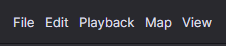

Every command is also in the menus: File, Edit, Playback, Map and View.

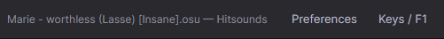

- **Preferences**: your Songs folder, audio output and key commands (you can import your Cubase keys).
- **Keys / F1**: a searchable list of every shortcut and mouse action.

### Tools

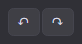 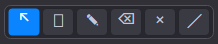

Undo and redo with Ctrl+Z and Ctrl+Y. Pick a tool with its button or number key:

| Tool | Key | What it does |
|---|---|---|
| Select | 1 | Click a hit to select it, Ctrl/Shift+click to add more, drag a box around several, drag to move them. |
| Range | 2 | Drag a time range across lanes, then **Edit → Edit range…** to copy, move or delete it. |
| Draw | 3 | Click or drag along a lane to place hits. Hold Alt to draw with any tool. |
| Erase | 4 | Drag across hits to remove them. Right-click deletes a hit with any tool. |
| Mute | 5 | Silence a hit while you listen. Mutes are never saved into the map. |
| Ramp | 6 | Drag in the volume controller to draw a smooth volume ramp. |

### Snap, view and zoom

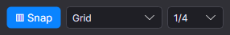

- **Snap** (J): when on, hits land on the beat grid.
- **Grid / Grid relative**: put moved hits on grid lines, or move them by whole steps and keep their offset.
- **1/4, 1/8…**: how fine the grid is (Shift+1–9).

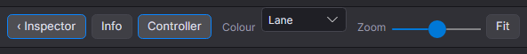

- **Inspector, Info, Controller**: show or hide those panels.
- **Colour**: colour hits by lane, or by volume (quiet hits dark, loud hits bright).
- **Zoom** (also Ctrl+wheel), and **Fit** to see the whole map.

### Selection and song

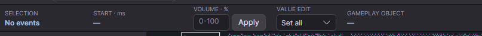

Shows what's selected. Type a volume and press **Apply**: *Relative* adds it to each hit, *Set all* gives them all that value.

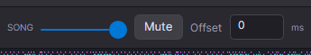

The song's volume, mute and offset (in ms). These are for listening only and aren't saved into the map.

### Inspector

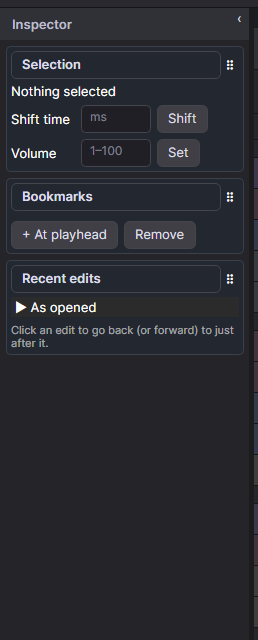

Shift or set the volume of the selection, add bookmarks, and click any entry under **Recent edits** to go back to it. Click a card's title to fold it; drag ⠿ to reorder cards.

### Lanes and the grid

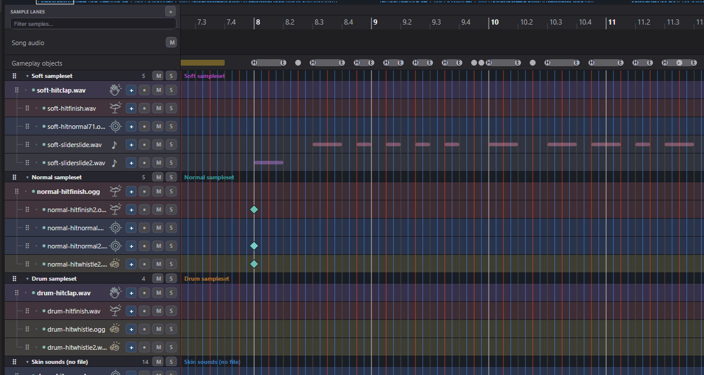

- **Sample lanes**: one lane per sample, grouped by sampleset. Use the filter to find one, and **+** to add a lane for another sample file.
- **Lane buttons**: **+** adds a lane, **●** plays the sample, **M** mutes the lane and **S** solos it.
- **The grid**: your hitsounds in time, left to right. Red-striped columns can't be saved as drawn yet.

### Volume

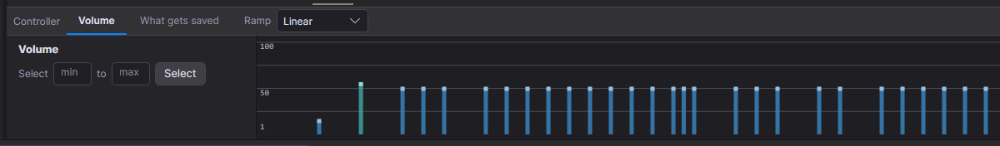

One bar per circle or slider end. Drag a bar to change its volume, Alt-drag to paint, Shift-drag for a ramp. osu! has one volume per object, so all lanes on that object share it.

### Playback

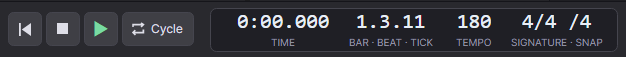

Go to start, stop, play (Space) and **Cycle** between the L and R markers (L). Ctrl+click the ruler to set L, Alt+click to set R. Next to it: the time, bar.beat.tick, tempo and time signature.

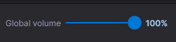

**Global volume** turns the song, hitsounds and previews up or down together.
